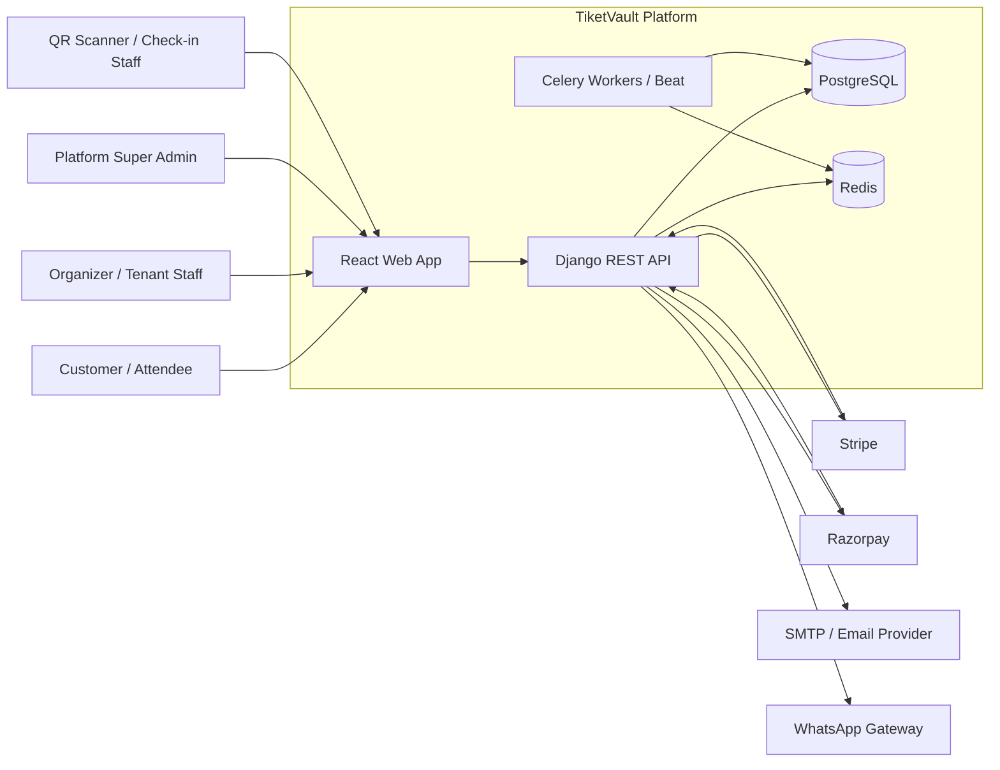
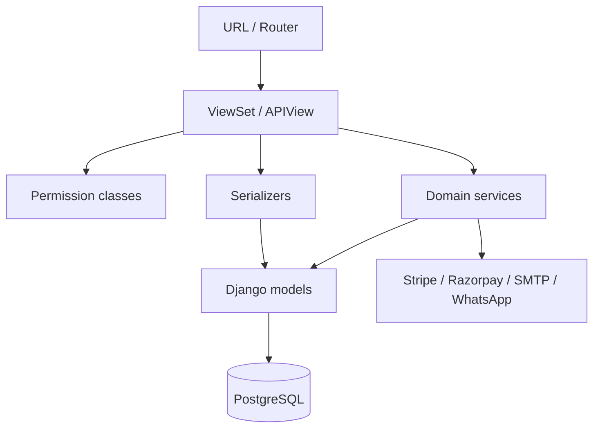
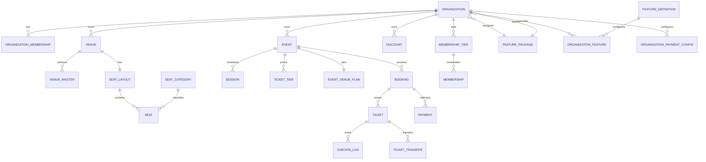
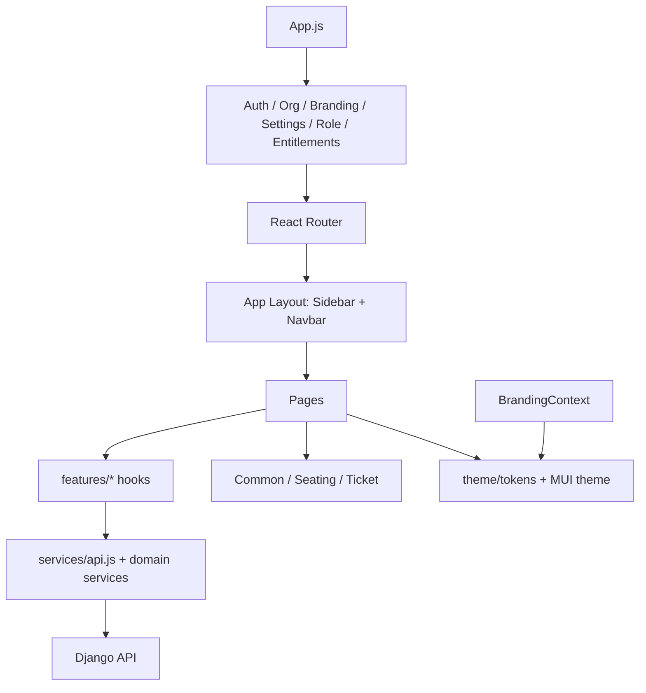
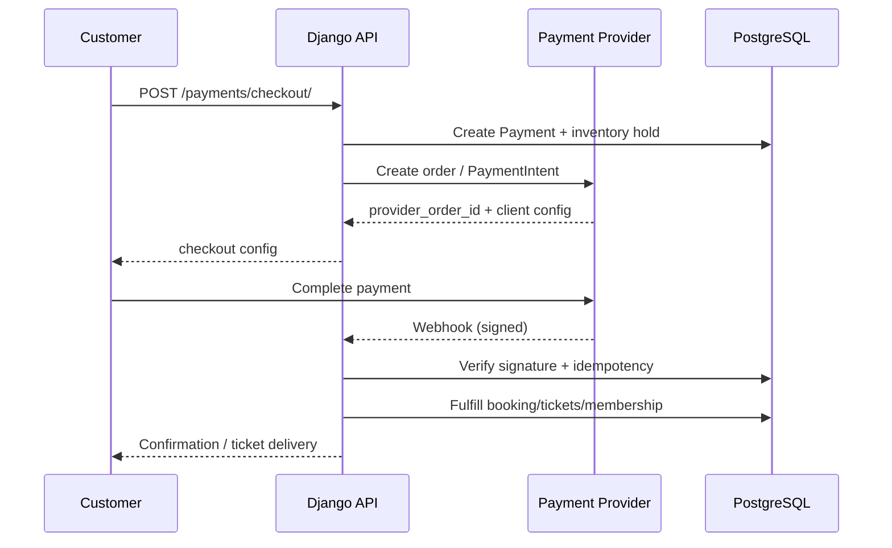

# TiketVault — Product Architecture

**Document status:** Current-state architecture  
**Product:** TiketVault multi-tenant event ticketing platform  
**Repository:** `/Users/roshankumarbharathan/Projects/TicketVolt`  
**Last aligned to code:** 12 November 2026

---

## 1. Purpose and scope

TiketVault is a multi-tenant ticketing and event-operations platform. It lets organisations create and publish events, sell or register attendees, manage seating and venues, issue tickets, check attendees in, sell memberships, accept donations, run reports, and use feature entitlements.

This document describes:

- system context and runtime topology
- backend and frontend architecture
- tenancy and access-control model
- domain modules and data ownership
- key services and workflows
- payment, feature entitlements, branding and reporting subsystems
- security, deployment and operational constraints

It is a current-state document. Planned capabilities that are not implemented are called out explicitly.

---

## 2. System context



### Runtime components

| Component | Responsibility |
|---|---|
| React SPA | All tenant, customer and platform-admin UI |
| Django REST API | Business logic, authorization, payment orchestration, reports |
| PostgreSQL | System of record |
| Redis | Celery broker/cache and transient coordination |
| Celery worker/beat | Event status updates, payment reconciliation and cleanup |
| Stripe / Razorpay | Ticket and membership payments |
| SMTP | Magic links, OTPs, booking confirmations, receipts |
| WhatsApp gateway | Optional notification/booking channel |

---

## 3. Technology stack

### Backend

- Python 3.11
- Django 4.2.7
- Django REST Framework 3.14
- SimpleJWT 5.3
- PostgreSQL (`psycopg2-binary`)
- Celery 5.3 + django-celery-beat/results
- Redis
- ReportLab 4.0.9 for PDF tickets and donation receipts
- Pillow for image/ticket rendering
- `cryptography` for tenant payment-secret encryption
- Stripe and Razorpay SDKs

### Frontend

- React 18.2
- React Router 6
- MUI 5 + Emotion
- styled-components 6
- Axios
- i18next / react-i18next (English, Traditional Chinese)
- Konva / react-konva for seating canvases
- Recharts for analytics
- react-toastify

### Infrastructure

- Docker Compose for local development
- Nginx-served production React bundle
- PostgreSQL and Redis containers
- Environment-driven configuration for secrets and provider keys

---

## 4. Repository structure

```text
TicketVolt/
├── backend/
│   ├── core/                     # settings, middleware, permissions, URL root
│   ├── ticket_bookings/
│   │   ├── api/                  # DRF viewsets, APIViews, serializers, PDFs
│   │   ├── migrations/
│   │   ├── services/             # tenancy, payments, features, venue versioning...
│   │   ├── management/commands/
│   │   ├── models.py             # core models
│   │   ├── models_tenancy.py     # Organization + memberships
│   │   ├── models_payments.py    # payments, refunds, webhooks, tenant config
│   │   ├── models_seating.py     # layouts, seats, reservations
│   │   ├── models_event_venue.py # event-pinned venue plans
│   │   ├── models_venue_master.py
│   │   ├── models_membership.py
│   │   ├── models_features.py
│   │   ├── models_commercial.py
│   │   ├── tasks.py
│   │   └── urls.py
│   └── requirements.txt
├── frontend/
│   ├── src/
│   │   ├── pages/
│   │   ├── components/
│   │   ├── context/              # auth, org, role, branding, entitlements, settings
│   │   ├── features/             # booking/event hooks and payload builders
│   │   ├── services/             # Axios API clients
│   │   ├── theme/                # brand tokens + MUI theme
│   │   ├── styles/               # global CSS and CSS variables
│   │   └── locales/
│   └── package.json
├── QRScannerApp/                 # React Native scanner companion
├── shared/                       # Shared assets/config
└── docker-compose.yml
```

---

## 5. Backend architecture

### 5.1 Layering



- **Views** handle HTTP shape, authentication, status codes and throttling.
- **Serializers** validate input and expose output fields.
- **Services** own invariants that must be shared across views, tasks and commands.
- **Models** own persistence, local invariants and derived properties.
- **Managers/querysets** own canonical status filters and tenancy scoping.

### 5.2 Tenancy

The tenant boundary is `Organization`.

Every tenant-owned row carries an `organization` FK — directly (Venue, Event, Discount, CancellationPolicy, MembershipTier, OrganizationFeature, Payout) or transitively (Booking → Event, Ticket → Booking, Seat → Layout → Venue).

`services/tenancy.py` is the canonical visibility layer:

- `visible_events`, `visible_bookings`, `visible_tickets`
- `can_manage_org`, `can_operate_org`
- `user_org_ids`, `paid_membership_org_ids`
- `publicly_visible_events`, `events_visible_to_buyer`
- `filter_organization_param`

**Rule:** only `User.is_superuser` sees all tenants. `is_staff` is Django-admin access, not a cross-tenant data privilege.

### 5.3 Role model

| Layer | Role | Meaning |
|---|---|---|
| Platform | `is_superuser` | All organisations, all platform settings |
| Platform | authenticated user | Own data and permitted public/member content |
| Tenant | `admin` + `is_owner=True` | Organisation owner |
| Tenant | `admin` | Organisation administrator |
| Tenant | `staff` | Operational staff |
| Tenant | `member` | Organisation member |

Ownership is a **property of an Admin-level membership**, not a separate role. A live owner is unique per organisation.

Paid `Membership` is a separate concept: a customer's paid subscription to a tenant's membership programme. It does not grant organisation management rights.

### 5.4 API surface

The API is versionless under `/api/` and exposed through DRF routers plus explicit paths. Main resources:

- `events`, `venues`, `bookings`, `discounts`, `templates`
- `organizations`, `users`, `memberships`, `membership-tiers`
- `payouts`, `audit-logs`, `reports`, `analytics`, `dashboard`
- `platform/features`, `platform/feature-packages`, `platform/organization-features`
- `payments`, `webhooks`, `checkin`, `qr`
- seat maps, venue layouts, seat categories

Detailed endpoint list is in `FUNCTIONAL_SPEC.md`.

### 5.5 Key domain services

| Service | Responsibility |
|---|---|
| `services/tenancy.py` | Tenant scoping and role gates |
| `services/venue_versioning.py` | Immutable venue-master versions and event pinning |
| `services/event_venue_plan.py` | Event-specific seat plan and snapshot |
| `services/event_pricing.py` | Ticket/seat pricing |
| `services/seat_layout_parser.py` | SVG seat extraction |
| `services/payments/` | Provider abstraction, encryption, webhook parsing |
| `services/payment_fulfillment.py` | Payment → booking/ticket fulfillment |
| `services/membership_fulfillment.py` | Membership purchase lifecycle |
| `services/features.py` | Feature package and per-tenant entitlement resolution |
| `services/commercial.py` | Invoice numbering, payouts, transfers, audit |
| `services/donation_receipt.py` | HK donation tax receipts |
| `services/booking_emails.py` | Transactional email and PDF attachment |
| `services/cancellation_policy.py` | Refund policy snapshots/calculations |

### 5.6 Async processing

Celery handles:

- event completion and sold-out transitions
- token/OTP cleanup
- payment reconciliation
- email/WhatsApp delivery where asynchronous

`/api/cron/run-tasks/` provides a token-protected HTTP cron entrypoint for deployments without a scheduler.

---

## 6. Data architecture

### 6.1 Domain groups

| Domain | Core models |
|---|---|
| Tenancy & identity | Organization, OrganizationMembership, OrganizationInvite, OrganizationContact, UserProfile |
| Venue & seating | Venue, SeatLayout, SeatCategory, Seat, SeatReservation, VenueMaster, EventVenuePlan, EventSeatCategory |
| Events | Event, Session, TicketTier, CancellationPolicy, EventTemplate |
| Commerce | Booking, Ticket, Discount, DiscountUsage, Payment, PaymentRefund, WebhookEvent, InventoryHold |
| Memberships | MembershipTier, Membership, MembershipDependent, MembershipPayment |
| Feature entitlements | FeatureDefinition, FeaturePackage, OrganizationFeature |
| Operations | CheckInLog, TicketTransfer, OrganizerPayout, AuditLog, PatronContact |
| Configuration | SystemSettings, OrganizationPaymentConfig |

### 6.2 Core relationships



### 6.3 Venue versioning

Venue seating is versioned:

1. A venue has a mutable current layout and a `VenueMaster` snapshot.
2. Editing a layout creates an immutable master version.
3. An event pins the exact `EventVenuePlan` version at creation/publish.
4. Published events keep a frozen snapshot, so later venue edits do not mutate sold seating.

### 6.4 Event cancellation, transfers and check-in identity

- Cancelling an event captures a required `cancellation_reason` on the event; cancelled events are excluded from public sale.
- Accepting a ticket transfer regenerates the ticket `unique_code` and QR payload, invalidating the previous holder's QR.
- Check-in audit rows identify the authenticated admin/staff `scanner_user` in addition to device, IP and location.
- There is no scheduled job that transitions individual ticket statuses; those transitions are action-driven.

### 6.5 Booking and inventory

- `Session.booked` and `TicketTier.quantity_sold` are committed inventory.
- `Session.reserved` / `TicketTier.quantity_reserved` are in-flight holds.
- Seat reservations add a third layer for reserved seating.
- `InventoryHold` expires holds.
- Payment fulfillment converts holds into sold inventory and issues tickets.

---

## 7. Frontend architecture



### 7.1 Contexts

| Context | Responsibility |
|---|---|
| `AuthContext` | Login state, JWT, user, logout |
| `OrgContext` | Memberships, current org, role, owner flag |
| `RoleContext` | Platform and org role helpers |
| `SettingsContext` | Currency, locale, timezone; tenant overrides |
| `EntitlementsContext` | Effective feature package and feature flags |
| `BrandingContext` | Tenant name, logo, colours, favicon, language |

### 7.2 Theming

- `theme/tokens.js` is the single source of brand tokens.
- `theme/muiTheme.js` maps tokens into MUI.
- `styles/global.js` exposes `--tv-*` CSS variables and global overrides.
- `BrandingContext` applies tenant colours/logo at runtime.
- No hardcoded hex colours should exist outside the theme layer.

### 7.3 Route protection

- `ProtectedRoute` — authenticated.
- `RoleBasedRoute` — platform superuser only.
- `OrgRoleRoute` — organization membership threshold.
- `EventsEntry` — chooses public browse vs workspace based on membership.
- `GuestAllowedRoute` — public booking checkout.

### 7.4 Main routes

| Route | Purpose |
|---|---|
| `/` | Public landing and events |
| `/login`, `/register`, `/auth/verify` | Authentication |
| `/app/dashboard` | Dashboard |
| `/app/organizations` | Organisation and team management |
| `/app/events/*` | Event list, create, edit, detail |
| `/app/venues/*` | Venue list, create, layout editor, detail |
| `/app/bookings` | Booking management |
| `/app/bookings/create` | Public/member checkout |
| `/app/reports` | Reports |
| `/app/payouts` | Payouts and settlements |
| `/app/audit-logs` | Audit trail |
| `/app/payment-settings` | Tenant gateway credentials |
| `/app/features` | Superuser feature definitions, packages and org overrides |
| `/app/payouts` | Organizer payouts and settlements |
| `/app/audit-logs` | Audit trail |
| `/app/checkin` | QR scanner |
| `/app/analytics` | Analytics |
| `/app/settings` | Platform/tenant settings |

---

## 8. Payments architecture

### 8.1 Ticket payments



- Providers: Razorpay and Stripe.
- Credentials: platform-level environment keys, or per-tenant `OrganizationPaymentConfig` when active.
- Tenant secrets are encrypted at rest using a key derived from `SECRET_KEY`.
- Webhooks: global routes and per-tenant `/payments/webhook/<org_id>/<gateway>/`.
- Idempotency: `WebhookEvent`.
- Payment → booking fulfillment is transactional.

### 8.2 Feature entitlements and payments

Ticket and membership payments are tenant commerce. Feature entitlements do not process payments; they control which capabilities a tenant can use.

---

## 9. Feature entitlements

### 9.1 Model

- `FeatureDefinition` — a capability key (e.g. `public_event_page`, `donation_quick_picks`, `event_bilingual`), name, category, default state.
- `FeaturePackage` — a named set of feature keys; one may be the default package.
- `OrganizationFeature` — per-tenant enabled/disabled override with optional JSON config.
- `Organization.feature_package` — the assigned package.

### 9.2 Resolution

`services/features.py` resolves the effective feature set:

1. Start with the organisation's assigned package.
2. If no package is assigned, use the default active package.
3. Apply per-organisation overrides (enable or disable).
4. Ignore inactive feature definitions.

### 9.3 Enforcement

- Public event page requires `public_event_page`.
- Donation presets/contact text require `donation_quick_picks`.
- Bilingual event fields require `event_bilingual`.
- Feature management is superuser-only at `/app/features` and `/api/platform/features/`, `/api/platform/feature-packages/`, `/api/platform/organization-features/`.
- Tenant-readable effective features: `/api/features/mine/`.

There is no platform subscription billing in the current codebase. Platform pricing/subscription models were removed in migration `0060_remove_platform_licensing`.

## 10. Security architecture

### 10.1 Authentication

- JWT access/refresh tokens.
- Password login and magic-link/OTP flows.
- Magic links are single-use, expiring, and audited.
- Active-session tracking for platform admins.

### 10.2 Authorization

- Platform superuser is the only cross-tenant role.
- Org roles enforced through `can_manage_org` / `can_operate_org`.
- Querysets are scoped through canonical `visible_*` helpers.
- Object-level access checks on bookings, tickets and payments.
- Feature entitlements.

### 10.3 Data protection

- Tenant payment secrets encrypted at rest.
- Webhook signatures verified.
- CORS allowlist.
- CSRF/session middleware for Django admin paths.
- Audit logs for mutating API requests.
- Soft deletion/removal timestamps for memberships.

### 10.4 Known security limitations

- SSO/SAML not implemented.
- No granular custom roles.
- No automated data-retention enforcement.
- No DPA/SLA workflow engine.
- No data-residency controls.
- Audit logs capture request metadata, not full before/after object diffs.
- Credential encryption key rotation is not automated.

---

## 11. Deployment and operations

### 11.1 Local Docker topology

| Service | Role |
|---|---|
| `backend` | Django runserver |
| `frontend` | Nginx-served React build on port 3000 |
| `postgres` | PostgreSQL |
| `redis` | Celery broker/cache |

### 11.2 Configuration

Environment-driven configuration includes:

- `SECRET_KEY`, `JWT_SIGNING_KEY`, `TICKET_SIGNING_SECRET`
- database credentials
- Stripe/Razorpay keys and webhook secrets
- SMTP credentials
- WhatsApp gateway URL/token
- CORS/allowed hosts
- cron secret

### 11.3 Migrations

Django migrations are the schema source of truth and must be applied before deployment. Current migrations extend through `0068_event_cancellation_reason`. They include branding, payment configuration, commercial operations, tax-receipt configuration, feature entitlements, PatronContact and event cancellation reason.

### 11.4 Observability

- Structured Django logging.
- Webhook and payment logs.
- Audit log table.
- Cron health endpoint.
- Celery task results.
- No external APM/tracing integration currently.

---

## 12. Extensibility and constraints

### Extensible

- Add payment providers via `PaymentProvider` interface.
- Add feature keys to `FeatureDefinition` and packages via `FeaturePackage`.
- Add new report datasets in `reports_api.py`.
- Add ticket formats/templates.
- Extend tenant branding fields.
- Add operations models without changing tenancy boundaries.

### Current constraints

- Public custom-domain routing is resolved in middleware but full domain-based frontend rendering/DNS automation is incomplete.
- Platform subscription billing is not part of the current product; feature packages are assigned by superusers.
- No resale marketplace or dynamic pricing engine.
- No automated organizer bank payouts.
- No SSO/SAML.
- Tax rates are stored per tenant but not yet applied to booking totals.
- Tenant logo/favicon are URL fields, not uploaded assets.
- Only English and Traditional Chinese locale bundles exist.

---

## 13. Recent product changes reflected in this document

| Change | Effect |
|---|---|
| Platform licensing removed (`0060`) | No PlatformPlan/Subscription/Invoice; replaced by feature packages and per-org overrides |
| Tax-receipt configuration (`0061`–`0062`) | Organisation-level IRD/Section 88, registered address, signatory, receipt prefix, thresholds and bilingual fields |
| Checkout consent/reminders (`0063`) | Booking privacy acceptance, marketing opt-in, course question, reminder timestamps |
| Feature entitlements (`0064`–`0065`) | Feature definitions, packages and per-tenant overrides |
| Public donation fields (`0066`) | Donation presets, contact text, public page toggle and bilingual event content |
| PatronContact (`0067`) | Outreach tracking per booking |
| Event cancellation reason (`0068`) | Conditional reason captured when an event is cancelled |

## 14. Architecture decision summary

| Decision | Rationale |
|---|---|
| Organization is the tenant boundary | Simple, enforceable scoping |
| One live owner per org, stored on membership | Avoids dual ownership sources |
| Superuser-only cross-tenant visibility | Prevents staff privilege leakage |
| Immutable venue-master versions | Historical seat integrity |
| Event pins venue plan | Published events cannot change underneath buyers |
| Service layer for tenancy/payments/features | Single source of truth |
| Separate platform feature entitlements from customer memberships | Different access concerns |
| Feature entitlements in plan JSON | Fast plan changes without schema changes |
| Per-tenant payment config encrypted | Supports larger tenants without global merchant account |
